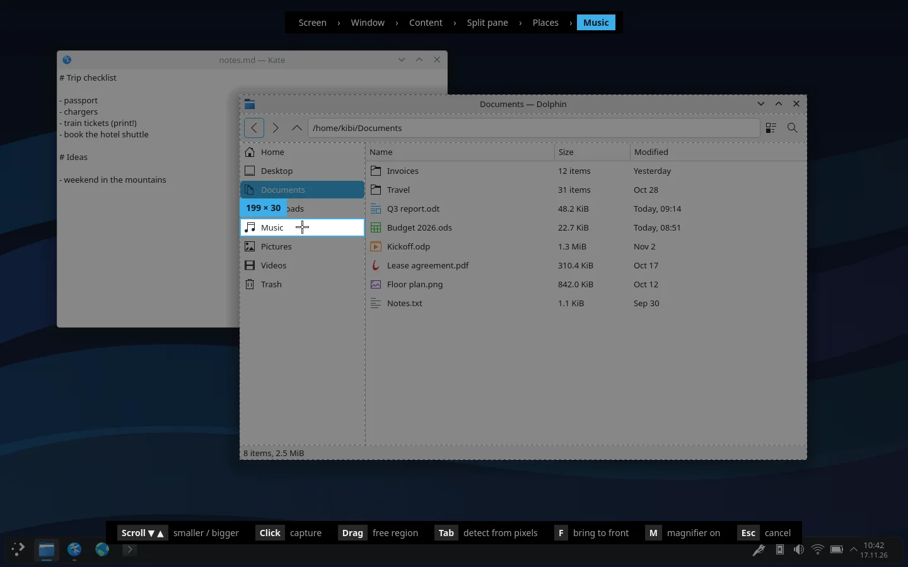
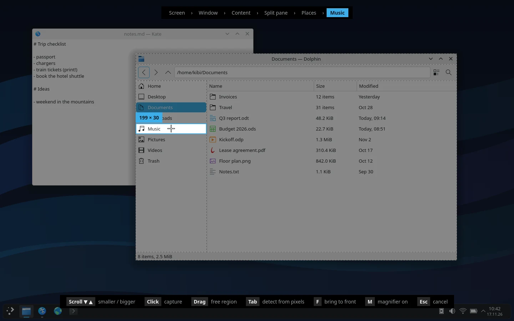

<p align="center"></p>

# Snappie

*Snap it like a magpie.* Screenshots, annotation, screen recording and sharing for KDE Plasma 6 on
Wayland, like ShareX on Windows. Pick a screen, a window, or a part of a
window (a panel, a terminal pane, a browser tab's page area, …), then annotate,
copy, save, upload, pin or record it. There's no screen-share dialog.

<p align="center"></p>

```sh
./install.sh          # puts `snappie` on PATH, launcher + shortcut entries, autostart
snappie               # starts the tray app in the background
snappie --foreground  # run in the terminal for debugging
snappie --help        # all commands
```

`install.sh` links `snappie` into `~/.local/bin`. If that folder isn't on your
PATH yet (as on Arch), it adds it to `~/.bashrc` (or `~/.zshrc`, or a fish
`conf.d` file). Open a new terminal afterwards.

## Requirements

KDE Plasma 6 (Wayland), Python 3 with PyQt6, dbus-python, PyGObject, NumPy and
Requests, GStreamer with the PipeWire, base, good and VA plugins, ffmpeg, and
the Wayland client library. Source installs also need gcc + Wayland headers
to build the capture helper. Optional: tesseract (OCR),
python-evdev (clicks and keys in recordings), the PipeWire tools `pw-cli`,
`pw-dump` and `pw-link` (recording only some apps' sound), the OpenSSH client (SFTP uploads),
and CMake, a C++ compiler and the KF6 Purpose headers (the Share menu entry).

`snappie deps` checks all of it and prints the install command for your distro;
`install.sh` runs it first. On Arch and its derivatives:

```sh
sudo pacman -S --needed python-pyqt6 qt6-svg python-dbus python-gobject python-numpy \
    python-requests gstreamer gst-plugin-pipewire gst-plugins-base gst-plugins-good \
    gst-plugin-va gst-plugins-bad-libs ffmpeg wayland
sudo pacman -S --needed gcc pkgconf   # source installs (including install.sh)
sudo pacman -S --needed tesseract tesseract-data-eng python-evdev   # optional
sudo pacman -S --needed cmake purpose   # optional: Share menu entry
```

On openSUSE:

```sh
sudo zypper install python3-PyQt6 python3-dbus-python python3-gobject python3-numpy \
    python3-requests typelib-1_0-Gst-1_0 gstreamer-plugin-pipewire gstreamer-plugins-base \
    gstreamer-plugins-good gstreamer-plugins-bad ffmpeg libwayland-client0
sudo zypper install gcc pkgconf-pkg-config wayland-devel   # source installs
sudo zypper install tesseract-ocr tesseract-ocr-traineddata-english python3-evdev pipewire-tools   # optional
sudo zypper install cmake gcc-c++ kf6-purpose-devel kf6-kcoreaddons-devel qt6-dbus-devel   # optional: Share menu
```

On Debian 13 and newer, Kubuntu 25.04 and newer, KDE neon and their derivatives:

```sh
sudo apt install python3-pyqt6 python3-pyqt6.qtsvg python3-dbus python3-gi python3-numpy \
    python3-requests gir1.2-gstreamer-1.0 gstreamer1.0-pipewire gstreamer1.0-plugins-base \
    gstreamer1.0-plugins-good gstreamer1.0-plugins-bad ffmpeg libwayland-client0
sudo apt install gcc pkg-config libwayland-dev libwayland-bin   # source installs
sudo apt install tesseract-ocr tesseract-ocr-eng python3-evdev pipewire-bin   # optional
sudo apt install cmake g++ libkf6purpose-dev libkf6coreaddons-dev qt6-base-dev   # optional: Share menu
```

## Python package installation

Snappie can also be installed as a Python package, without `install.sh` or a checkout.
Download the wheel for your CPU from [GitHub Releases](https://github.com/licentiapoetica/snappie/releases):
`x86_64` for Intel/AMD PCs or `aarch64` for ARM64. Release wheels need glibc 2.35
or newer. They include the compiled capture helper, so you don't need gcc or the
Wayland headers. You still need the other system packages listed above. The
optional Share menu plugin isn't in the wheel; Snappie builds it on your computer
when its packages are installed.

Install it into a virtual environment that can use your distro's Python libraries:

```sh
python3 -m venv --system-site-packages ~/.local/share/snappie/venv
~/.local/share/snappie/venv/bin/python -m pip install --no-deps ~/Downloads/snappie-VERSION-py3-none-manylinux_2_35_x86_64.whl
~/.local/share/snappie/venv/bin/snappie deps
mkdir -p ~/.local/bin
ln -sf ~/.local/share/snappie/venv/bin/snappie ~/.local/bin/snappie
~/.local/share/snappie/venv/bin/python -c 'from snappie import hotkeys; hotkeys.install()'
```

Use the name of the file you downloaded. `deps` lists anything still missing.
If your shell can't find `snappie` afterwards, `~/.local/bin` isn't on your PATH.
Add `export PATH="$HOME/.local/bin:$PATH"` to `~/.bashrc` and open a new terminal.
The last line adds the launcher and the shortcut actions. Then start `snappie`
and turn on **Start Snappie with Plasma** in Settings → Hotkeys if you like.
Keep the environment where it is; the desktop entries point to it. To upgrade,
install the new wheel with the same command. To check the download, save
`SHA256SUMS` next to it and run `sha256sum --ignore-missing -c SHA256SUMS`.

To install from a checkout instead, use `.` in place of the wheel file. That
builds the capture helper, so it needs gcc, pkg-config, wayland-scanner and the
Wayland headers. For development, use `pip install --no-deps -e .`. The `input`
extra installs evdev for showing clicks and keys; `dev` adds pytest and `build`.
`python -m build` makes a wheel and a source archive. Builds don't register
desktop entries or write to your user data directory.

## Tray and shortcuts

`snappie` runs in the tray. Click: screenshot. Middle click: record. Right
click: everything else (delays, last area, GIF, OCR, color picker, scrolling
capture, history, settings). Starting with Plasma is set in Settings → Hotkeys.

Starting `snappie` (or `snappie tray`) returns to the terminal once the tray app
is ready. It keeps running when that terminal closes. Use `snappie --foreground`
or `snappie tray --foreground` to stay attached and see diagnostics in the terminal.
Application logs are in `~/.local/state/snappie/snappie.log`; background console
output and startup errors are in `~/.local/state/snappie/console.log` (or under
`$XDG_STATE_HOME` when set). Stop the tray app with `snappie quit`.

Every action is also a command, and a global shortcut you can assign in
**System Settings → Shortcuts → snappie** (none are set by default):

| command                     | does                                                  |
|-----------------------------|-------------------------------------------------------|
| `snappie shot`            | screenshot: pick an area                              |
| `shot --screen / --window`  | the screen under the cursor / the active window       |
| `shot --last`               | the same area again (follows the window if it moved)  |
| `shot --delay 5`            | countdown first (for menus and tooltips)             |
| `shot --then copy,save,…`   | skip the editor: copy, save, upload, pin, ocr, edit   |
| `snappie record`          | record an area; run again to stop                     |
| `record --gif` / `--webp`   | record an animated GIF / WebP                         |
| `record --last`             | record the same area again                            |
| `pause`, `draw`, `stop`     | control the running recording                         |
| `color`                     | pick a color, copies its hex code                     |
| `ocr`                       | pick an area, copies its text (needs tesseract)       |
| `ocr FILE`                  | copies the text of an image file                      |
| `scroll`                    | scrolling capture of a window area                    |
| `history`, `settings`       | windows                                               |
| `edit FILE`, `pin FILE`     | open an image (or a video) in the editor, pin it      |
| `upload FILE…`              | upload files, one after another                       |
| `upload -u NAME FILE…`      | upload with another uploader (name or `.sxcu` path)   |
| `convert FILE`              | open the convert window (any format, cut, crop)       |
| `convert --mp4 FILE`        | convert right away; also `--gif`, `--webp`, `--webm` |
| `deps`                      | check what is installed, print the install command    |

When the tray app is running, commands are handed to it instantly. Otherwise
the command runs on its own and the process exits when done.

**Dolphin:** right-click files → **Snappie** to upload them, annotate or pin
an image, copy the text in an image, cut and crop a video, or convert videos,
GIFs and WebPs into each other. Turn this menu off in Settings → Hotkeys.

**Share menus:** Spectacle, Gwenview, Okular and Dolphin get **Share → Upload
with Snappie**. The app shows the link when the upload is done, and Snappie
starts by itself if it isn't running. The entry is a small plugin that Snappie
builds on your computer (it needs the packages listed under Requirements), and
it shows up after you log in again once. Distro packages can build it with
`snappie/purpose/CMakeLists.txt` instead.

## Picking

<p align="center"></p>

For screenshots, the screen freezes. For recordings, it dims. The smallest
area under the cursor is highlighted, and a click takes it. Scroll up for
bigger ones, or point at the title bar to take the whole window:

| input             | action                                                     |
|-------------------|------------------------------------------------------------|
| scroll / ↑ ↓      | bigger (area → … → content → window → screen) or smaller   |
| Tab               | switch inner detection: accessibility tree ↔ from pixels   |
| click / Enter     | take the highlighted area                                  |
| drag              | a free rectangle                                           |
| middle click      | screenshots: record the area instead (in the picker or while annotating)  |
| F                 | bring a covered window to the front; again: the one behind |
| M                 | magnifier (pixel loupe with the color under the cursor)    |
| W                 | screenshots of a whole window: plain / transparent / shadow |
| C                 | recordings: include the mouse cursor                       |
| Esc / right click | cancel                                                     |

Switching to another app cancels the picker. Use the tray icon or a capture
shortcut to start a fresh selection.
The bottom shortcut bar fades when you point at it, so you can pick or drag
through it while the magnifier keeps following the cursor.

**Transparent** and **shadow** window shots use the window's own pixels:
rounded corners stay transparent, it's correct even when other windows cover
it, and *shadow* adds a soft drop shadow around it.

## Annotating

After picking, a toolbar appears next to the area on the frozen screen:
arrow, line, rectangle, ellipse, text, pen, highlighter, marker, blur,
pixelate, redact, numbered steps, magnifier and crop. Shapes stay editable, and
the area can still be moved and resized. Drag the toolbar by its grip (or any
gap between buttons) to put it anywhere; double-click it to bring it back. Enter runs the after-capture actions
(default: copy + save). Esc cancels. The editor button opens a full editor
window with zoom, canvas crop and a frame panel (padding, background, rounded
corners, shadow).

## After capture

Copy, save (`~/Pictures/Snappie`), upload, pin to the screen (always on top;
wheel zooms), and OCR. Pick the defaults in Settings. Every capture lands in the
**history**, which shows thumbnails and lets you open, copy, upload, edit, pin
or delete. Opening a screenshot there opens it in Snappie's editor. That includes screenshots you only copied: Snappie keeps a copy in
`~/.local/share/snappie/clipboard/` and removes it when the history entry goes.

**Uploads** go to the uploaders you add in Settings → Uploads → **Add**:

- **ShareX custom uploaders:** import any `.sxcu` file (Zipline, XBackBone,
  catbox, …).
- **SFTP:** copies the file into a folder on your server over SSH. You give the
  folder's web address, and the link (`https://example.com/i/` + the file name)
  is copied like for any upload. It runs your
  system's `sftp`, so your SSH keys, ssh-agent and `~/.ssh/config` work as
  usual; a password works too. File names can be random, so links can't be
  guessed.
- **Command:** runs a program for each file, such as rclone, scp, s3cmd, curl
  or your own script. `{file}` is the path, `{filename}` the name,
  `{random}` a random name. The link is a template you set, or the last URL the
  program prints.
- **Plugins** for any other service: a short Python file in
  `~/.local/share/snappie/plugins/`. See
  [docs/uploader-plugins.md](docs/uploader-plugins.md).

The link is copied when done.
Several files upload one after another; when they're done, all the links are
copied. While uploading, the tray icon shows the percentage; cancel from the
tray menu. Settings → Uploads can also show it in Plasma's notifications, with
speed, time left and a Cancel button.

To check an uploader, use **Test Upload**, then **Show Response…** to see what
the server answered: status, headers and body. A JSON body shows as a tree;
click a value to get its `{json:…}` path. You can also try any expression
(`{json:…}`, `{regex:…}`, `{header:…}`) against the response.

The first upload to a server with a self-signed certificate, or to an SSH
server that isn't in `~/.ssh/known_hosts`, asks whether to trust it and shows
its fingerprint. **Trusted Servers…** lists them and can remove them.

**Sounds** for a screenshot, the start and end of a recording, a finished
upload, or an error can be turned on in Settings → Sounds. They come from your
sound theme, or pick your own files (WAV, OGG, FLAC, MP3, …). The start sound
plays before the recording begins, so it isn't recorded. They play even when
Plasma's notification sounds are muted, and get their own "Snappie" slider in
the volume applet.

## Recording

While recording, a small bar sits under the area: timer, pause, draw, sound,
microphone, stop.

- **Pause** leaves the paused time out of the file.
- **Draw** lets you draw on the area (pen; Shift for arrows, R for boxes,
  1–8 colors, wheel width, Z undo, C clear, Esc done). Drawings fade out.
- **Click and key visualizer** (Settings or `--clicks --keys`) shows mouse
  clicks as ripples and pressed keys as a bubble. It reads the input devices,
  so your user must be in the `input` group.
- **Sound** is asked for before each recording: a small panel under the area
  lists the apps playing sound and your microphone. Untick voice chat, music
  or a video you don't want in the recording, then press Enter (Esc cancels).
  Your choices are remembered for next time. Apps that start playing later
  follow Settings → Recording → Apps (all apps, only some, or all except
  some). The apps still play to your speakers.
- While recording, ♪ on the bar turns apps on and off, and the microphone
  button mutes and unmutes your mic.
- `--app NAME` and `--exclude-app NAME` pick the apps for one recording
  without asking (repeatable; the app name, its binary or its Flatpak id).
  Turn the question off in Settings → Recording.
- Picking apps needs the PipeWire tools (`pw-cli`, `pw-dump`, `pw-link`).
  Without them Snappie records the whole desktop ("All apps") or, if you
  chose apps, no desktop sound rather than all of it.

Stop with the bar, the tray icon, Ctrl+C, or `snappie stop`. Files go to
`~/Videos/Snappie/`.

## Capture

The tool records through KWin's own screen-cast API, the same one Spectacle
uses. A tiny helper binary (sources in `snappie/helper/`) is compiled into wheels.
Source checkouts and editable installs build it on demand and rebuild when its
sources change. On startup, Snappie puts the helper at a stable location in the
user data directory and authorizes it through a hidden `.desktop` entry, so KWin
never shows a dialog. Missing desktop entries are recreated automatically.
The same helper drives the auto-scrolling for scrolling capture, through KWin's
fake-input protocol.

- **Window or anything inside one**: the window's own stream. It stays correct
  when other windows cover it, and it follows the window when you move it.
  Recording stops when the window closes.
- **Screen or a dragged region outside a window**: a region stream of the
  desktop.

## Inner areas

There are two ways to find what's inside a window:

- **From pixels** (default for Chromium, Electron, and anything without an
  accessibility tree): the window is captured once and split along strong
  straight edges.
- **Accessibility tree** (default for KDE/Qt and GTK apps): real widgets with
  names. Chromium has one too if started with `--force-renderer-accessibility`.

## Output

- Native resolution, no scaling. Native frame rate (up to the monitor's
  refresh rate), with real frame timing; `--fps 60` forces a constant rate.
- HEVC through VAAPI, capped VBR: a bitrate ceiling sized to the area keeps
  games and video small, and a quality floor keeps static content crisp.
  Audio is Opus 192 kbps from the desktop or the chosen apps (`--mic` mixes
  in the microphone, `--no-audio` turns sound off).
- Recorded as MKV, so a crash won't lose the file, then remuxed losslessly to
  MP4 (or WebM with `--container webm`, or kept as MKV with `--mkv`).
- GIF uses one optimized palette for the whole clip (`gif.fps`, `gif.max_width`
  in Settings). WebP is smaller and has full color.
- `--quality high|good|small` changes the ceiling. `--qp N` uses a constant
  quantizer instead.
- `-c h264` is the most compatible. `-c av1` makes smaller files, but AMD can
  only encode AV1 in 64×16 blocks, so the area is rounded to that.
- `-c vp9` and `-c vp8` are for WebM, which browsers and chat apps play
  directly. Only Intel GPUs encode VP9; elsewhere VP9 and VP8 run on the CPU
  (libvpx, in `gst-plugins-good`), which is heavier for big areas. WebM holds
  only VP9, VP8 and AV1, so other codecs record as VP9 there. VP8 can't go in
  MP4, so it's saved as WebM.

## Converting

`snappie convert FILE` (or Dolphin's **Convert…**) opens a small window. Pick
GIF, animated WebP, MP4 or WebM, and set the frame rate, maximum width,
quality, speed and the part to keep. The window shows the size and length of
the result before you start. Progress and a Cancel button show up in Plasma's
notification area.

- Videos become GIFs or WebPs, and GIFs and WebPs become videos. GIFs and
  WebPs become each other too, and videos change container (MKV → MP4).
- When nothing about the picture changes, the video is copied, not
  re-encoded: lossless and fast.
- MP4 and WebM can't be transparent, so transparent parts of a GIF or WebP get
  a background color (white by default).
- **Remove black bars** finds letterbox or pillarbox bars and crops them off.
- **Repeat** plays a short clip several times in a row in the video.
- **Codec** picks the video codec: H.264, HEVC, AV1 or MPEG-4 for MP4, and
  VP9, VP8 or AV1 for WebM. VP8 is older and makes bigger files, but even old
  players and browsers play it. **Automatic** copies the video when it can and
  otherwise uses the best encoder your ffmpeg has. The window remembers your
  choice for each format.
- **File size** aims for a size, like 8 MB for a chat app's upload limit.
  Snappie works out the bitrate and leaves room for the sound. If the full
  picture doesn't fit well in that, it lowers the frame rate to 30 fps first,
  then picks the largest size that still looks clean (720p, 480p, …). The
  window shows what it chose, and you can still set the width or frame rate
  yourself. If a file still comes out too big, it's made once more with less.
  1 MB is 1,000,000 bytes, so it also fits limits counted in MiB.
- **Two passes** looks at the whole video first, then encodes it. It's slower,
  but hits a file size exactly and uses the bits better. It's ticked for you
  with a file size. Without one, it helps VP8, VP9 and AV1 (libaom); H.264 and
  HEVC look the same either way. OpenH264 can't do it.
- One quality scale (1–100) for every format: 80 is the default, and 100 makes
  a lossless WebP.
- Defaults for GIF / WebP and for videos are in Settings → GIF & Convert, or
  tick "Use these as the defaults" in the window.

Convert right away with the defaults, plus any of these options:

```sh
snappie convert --mp4 clip.gif                       # GIF → MP4
snappie convert --gif --fps 12 --width 640 demo.mkv  # video → small GIF
snappie convert --mp4 --start 0:05 --end 1:30 --cut 0:40-0:52 talk.mkv
snappie convert --webm --crop auto --speed 1.5 movie.mp4
snappie convert --webm -c vp8 clip.mkv               # WebM with VP8 instead of VP9
snappie convert --mp4 --size 8M recording.mkv        # fit in 8 MB
```

`-c CODEC` picks the video codec (`h264`, `hevc`, `av1`, `mpeg4`, `vp9`,
`vp8`). `--size 8M` aims for a file size (also `500k` or `1.5G`), always in two
passes, and `--two-pass` uses two passes without one. `--crop W:H:X:Y` keeps an
area (`auto` removes black bars), `--repeat N` plays it N times, `--background
'#000000'` sets the color behind transparency, `--no-audio` drops the sound,
`--reencode` never copies, and `-o FILE` picks the output. Without `-o`, the result goes next to the source and never
overwrites a file.

Snappie uses the encoders your ffmpeg has. If H.264 (libx264) is missing,
as in Fedora's and openSUSE's own ffmpeg, MP4 uses OpenH264 or MPEG-4.
ffmpeg reads animated WebP from version 8 on. With an older ffmpeg, Qt's WebP
plugin (`qt6-imageformats`) reads it instead.

## Cutting and cropping videos

`snappie edit video.mp4`, Dolphin's **Cut and Crop**, or double-clicking a
video in the history opens the video editor:

- **Split** (S) cuts the timeline at the playhead. Double-click a part, or
  select it and press Delete, to remove it. Do the same again to bring it back.
  Removed parts are skipped while playing, so you see the result.
- **Start here** (I) and **End here** (O) remove everything before or after
  the playhead.
- **Crop** (C) draws a box over the video. Pick a shape (16:9, 9:16, 1:1, …)
  or keep it free. **Remove black bars** finds the box for you. Outside crop
  mode the preview shows only the cropped part, as it will be exported.
- Space plays and pauses. Left and Right step one frame, and Shift steps
  faster. Ctrl+Z undoes.
- **Export…** (Ctrl+E) opens the convert window with your cuts and crop, so
  you can save the result as MP4, WebM, GIF or WebP.

## Files

Settings: `~/.config/snappie/settings.json`; uploaders:
`~/.config/snappie/uploaders/` (readable only by you when they hold a password);
uploader plugins: `~/.local/share/snappie/plugins/`; history and thumbnails:
`~/.local/share/snappie/`.

Coming from the old name (`screenrec`)? The first start of Snappie moves your
settings, uploaders, history and shortcuts over and removes the old entries.

## License

MIT, see [LICENSE](LICENSE).
